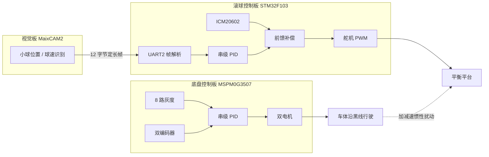

# 车载平衡滚球运动控制系统

底盘沿黑线循迹行驶，车上的平衡平台通过视觉闭环与惯性前馈把小球稳定在平台目标位置。

> 【待填】赛事 / 年份 / 题目，例如：全国大学生电子设计竞赛 20XX 年 X 题

## 系统架构



两块控制板各自独立闭环，没有板间通信：底盘不读取球的状态，滚球板也不控制车速；车体运动对小球的影响由滚球板上的 IMU 就地感知、前馈补偿。

## 硬件

| 部分 | 器件 | 说明 |
| --- | --- | --- |
| 底盘控制 | MSPM0G3507 | TI DriverLib，CMake + arm-none-eabi-gcc |
| 滚球控制 | STM32F103C8T6 | HAL 库，Keil MDK 工程 |
| 视觉 | MaixCAM2 | 识别球位置与球速，串口下发 |
| 姿态传感 | ICM20602 | 六轴 IMU（软件 I2C），测量车体加速度用于前馈 |
| 执行器 | 舵机（50 Hz PWM）+ 双直流电机 | 分别驱动平台倾角与底盘差速 |
| 反馈 | 8 路红外灰度、双路编码器 | 线位置、轮速与里程 |
| 交互 | OLED、板载按键、蓝牙串口 | 状态显示、模式切换、无线调参 |

## 目录结构

```
.
├── ball_balancer/   滚球平衡控制（STM32F103 + Keil MDK）
├── car_base/        底盘循迹控制（MSPM0G3507 + CMake）
└── README.md
```

两个子项目的编译方式、模块说明和已知问题见各自目录下的 README。

## 关键技术点

### 滚球平衡控制（ball_balancer）

- 串级 PID：位置环（位置式，输出/积分限幅）输出目标球速，速度环（增量式 + 一阶低通）输出舵机 CCR，33 ms 控制周期；位置死区内冻结输出，误差过零时重置积分与速度环
- 双前馈补偿：视觉球速阻尼前馈；ICM20602 车体加速度前馈（一阶低通 α=0.03、零偏校正、30 cm/s² 死区）
- 与视觉板的自定义串口协议：12 字节定长帧（0xAA55 帧头 / 0x0D0A 帧尾 + 两个 float），逐字节中断状态机非阻塞解析，配合数据新鲜度标志避免重复积分
- 手写软件 I2C（PB6/PB7）驱动 ICM20602，含零偏标定与单位换算
- 按键与视觉板双向握手：按键消抖后下发模式，视觉板回 ACK 后本板生效

### 底盘循迹控制（car_base）

- 20 ms 定时中断内完成双闭环：8 路灰度归一化加权求线位置 → 转向 PID；编码器测速 → 增量式速度 PI
- 双环输出差速驱动左右轮，速度设定值斜坡平滑起停
- 里程由轮速积分得到，实现多档速度下的定点停车
- 蓝牙串口环形缓冲 + `[a,b,c]` 文本帧解析，用于无线调参与数据回传

## 实测数据

【待填：这些数字比任何描述都有用】

| 指标 | 数值 |
| --- | --- |
| 小球稳态位置误差 | |
| 小车加减速时小球最大偏移（前馈前 / 前馈后） | |
| 循迹最大速度 / 是否脱线 | |
| 定点停车误差 | |
| 视觉帧率与控制周期 | |

## 分工与个人工作

【待填：面试官最先看这一段。把不是你做的部分明确写出来，比含糊带过更可信】

- 滚球控制：控制算法、串口协议、IMU 驱动、按键交互
- 底盘控制：循迹与速度双闭环、里程停车、蓝牙调参
- 视觉识别：MaixCAM2 上运行的识别程序（如非本人完成，请注明）

## 编译与烧录

- 滚球控制板：Keil MDK5 打开 `ball_balancer/MDK-ARM/HAL_oled.uvprojx`，目标 `HAL_oled`
- 底盘：需要 MSPM0 SDK 与 arm-none-eabi-gcc，`CMakeLists.txt` 中的 SDK 路径需按本机修改，详见 `car_base/README.md`

## 已知问题

- 滚球工程中早期遗留的 `MY_can.c` 未参与编译（依赖缺失的 `can.h`）；`PID.c` 里的轨迹生成器已实现但未接入控制回路
- 底盘转向 PID 的速度分段切换两档参数相同，暂未生效
- 底盘 `CMakeLists.txt` 与 `gdb_wrapper.bat` 内含作者本机工具链路径，克隆后需修改
